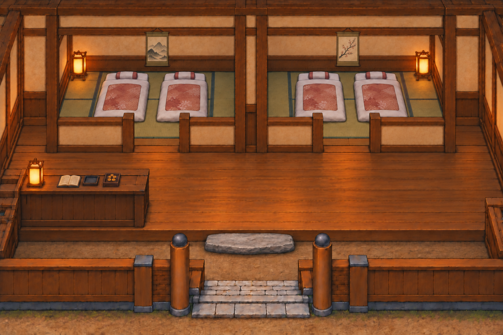
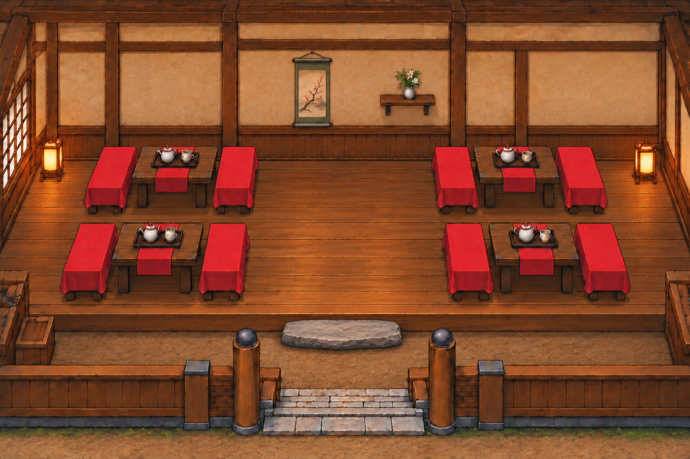
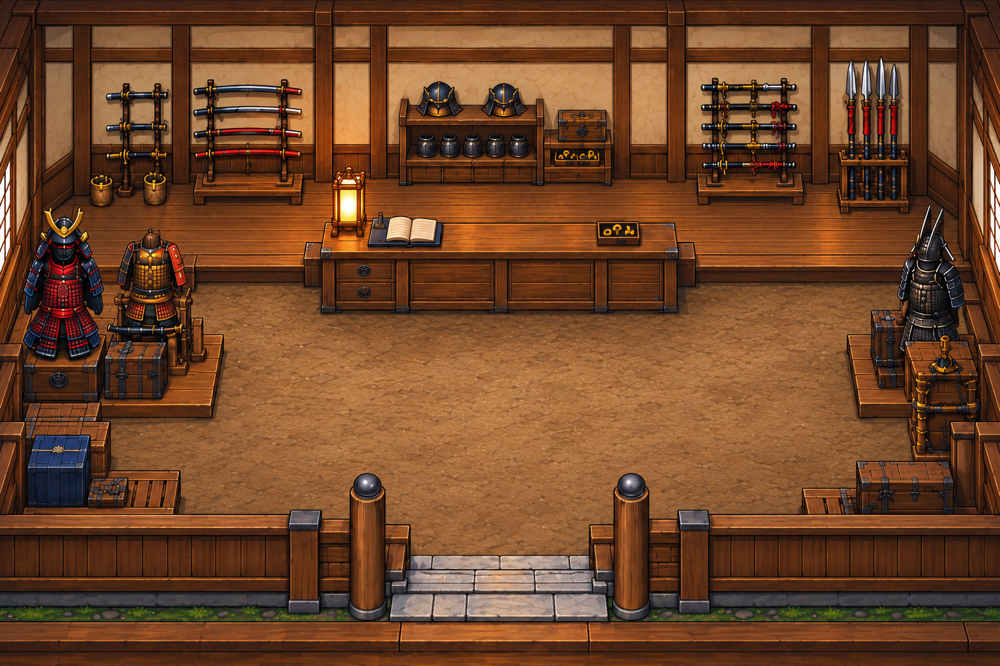
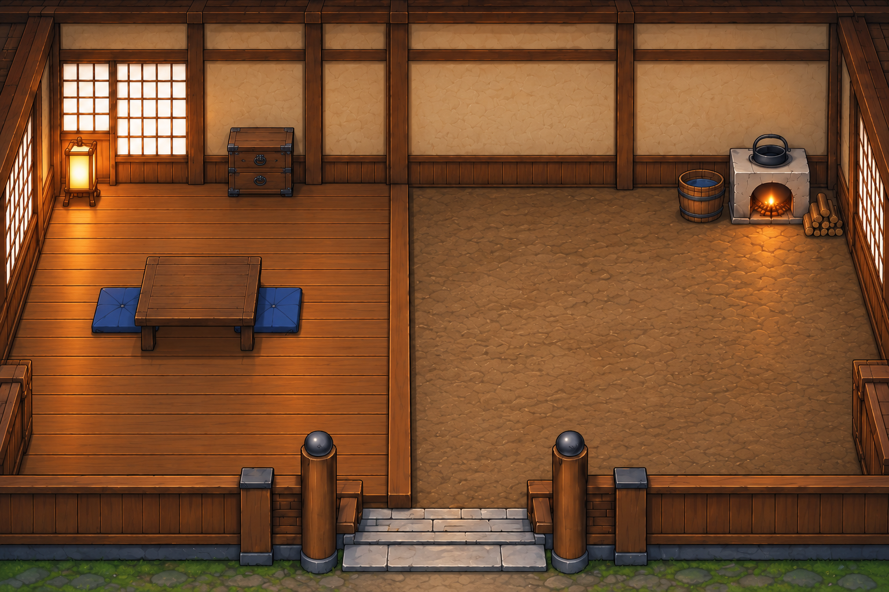

# 建物内観ベースイメージ v1
2026-10-15 / yaksha-hanamusubi

ゲーム実装前の個別コンセプト原画。4枚とも1536×1024 PNG。村内と同じ視点・遠近感・キャラクター尺度を維持する方針。実装時の投影・当たり判定・遮蔽・実機検査は別途必要。

|施設|画像|デザイン|
|---|---|---|
|宿屋|[inn.png](inn.png)|独立した畳客室2室、各2組の布団、山水・梅の掛け軸、小さな帳場、入口土間と踏み石|
|茶屋|[teahouse.png](teahouse.png)|入口付近のみ土間、踏み石と上がり框、板の間に4卓。カウンター・調理設備・外景窓なし|
|兵具屋|[armory.png](armory.png)|客用土間、壁際の武具、帳場背後の店員用板床と側面アクセス|
|汎用住宅|[home.png](home.png)|左板の間・右土間がおよそ半分ずつ。畳なし、少数の家具と小さなかまど|

## 共通条件
- 商業施設の基本デザインは各地で共通利用。茶屋はカウンター不要。
- 帳場を用いる施設では店員の立ち位置と出入り通路を確保する。
- 暖簾で別室への動線を作らない。
- 屋内だけ視点やキャラクター尺度を変更しない。
- 床・家具・前景・人物の分離は今後の実装工程。このPNGは統合されたベース原画。
- 茶屋・宿屋は会話で承認された最終画像をそのまま保管。兵具屋・住宅は承認済み比較案から個別生成。
- 組み込み画像生成で制作。既存ゲームの素材抽出ではない。
- この追加は資料保管のみ。本編コード・バージョン・セーブ形式は変更していない。

## 制作指示の要約
茶屋: 窓を除去し、土間と板の間の間に平たい踏み石。調理設備不要。
宿屋: 素朴な和風RPGのお宿、完全別室の客室、帳場背後の通路、掛け軸。
兵具屋: 比較案の左下を単独化、帳場を奥壁から離し店員の通路を確保。
住宅: 比較案の右下を単独化、左の板の間を奥から手前まで連続させ、右半分は土間。

